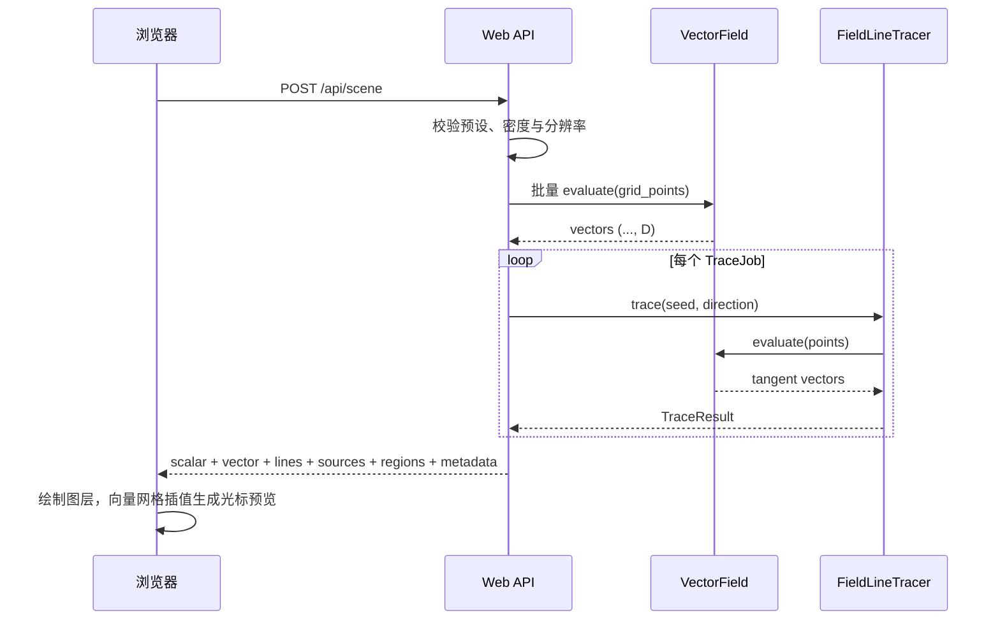

# 系统架构

VectorViz 使用 `src` 布局，并通过稳定的小接口连接物理、积分、服务与前端。依赖方向只能从外层指向内层：核心模型不得导入 Web 框架或绘图库。当前核心保持为几个小模块；当网格场、导入器和相对论动力学落地后，再按领域拆成子包。

## 目录结构

```text
Vector_field_streamline/
├── pyproject.toml
├── mkdocs.yml
├── docs/
├── notebooks/                  # Jupyter 教程与可复现实验
├── src/
│   └── vectorviz/
│       ├── __init__.py          # 稳定公共导出
│       ├── core.py              # VectorField、Domain、排除几何
│       ├── fields.py            # 解析场与组合场
│       ├── planar_fields.py     # 二维 Laplace 与斜率场
│       ├── material_fields.py   # 磁屏蔽圆柱壳解析场
│       ├── tracing.py           # 自适应场线积分与结果类型
│       ├── _trace_geometry.py   # 内置排除区的步内曲线检查（私有）
│       └── web/
│           ├── app.py           # HTTP API 与静态资源入口
│           ├── schemas.py       # 请求/响应契约
│           ├── seeding.py       # Web 预设的 TraceJob 播种策略
│           ├── scene.py         # 场景构建、采样、追踪与缓存
│           └── static/          # 无构建浏览器前端
└── tests/                       # 单元、验证、Web 契约测试
```

模块可以在保持下述依赖边界的前提下继续拆分。

## 分层与职责

| 层 | 负责 | 不负责 |
|---|---|---|
| `core.py` | 接口、区域、排除几何和共享数组约定 | 具体物理模型、HTTP、绘制 |
| `fields.py`、`planar_fields.py`、`material_fields.py` | 批量求值解析场、斜率场与组合场 | 播种、积分、颜色映射 |
| `tracing.py` | 方向归一化、双向积分、事件、终止信息 | 物理源公式、浏览器状态 |
| 验证代码 | 解析解、不变量、残差与收敛诊断 | 修改模型参数以“修好”结果 |
| Python Web 层 | 输入校验、预设播种、场景编排、静态资源、JSON 序列化 | 复制核心物理公式、改写核心积分政策 |
| 前端 | 参数交互、图层、提示信息，以及基于采样网格的近似预览 | 物理源公式、作为场景结果返回的自适应追踪 |

## 核心数据流



API 返回数值与科学元数据，而不返回预先栅格化的截图。这样前端可在不重复求解的情况下切换图层、调整颜色或查看探针。

物理公式只在核心实现一次。服务端直接对场模型自适应积分，并处理排除区、材料界面与终止原因；这些轨迹构成场景结果。浏览器允许对已采样向量网格做定步长 RK4 预览，但必须标识其近似性质，且点击后的手动场线仍由服务端求解。两条路径分别验证，预览不能替代核心的解析基准或收敛检查。

## 核心抽象

### `VectorField`

所有场实现都遵守一个批量接口：

```python
vectors = field.evaluate(points)
```

- `points` 的形状是 `(..., dimension)`；
- 返回值形状与 `points` 相同；
- 计算使用浮点数组，不能静默把结果截断为整数；
- 无效点应通过明确异常、mask 或非有限值政策处理；
- 实现不得根据当前色图或相机改变结果。

解析场、数值积分场、规则网格插值场和组合场都通过这一接口进入积分器。

### `Domain`

`Domain` 描述积分允许进入的空间范围，并为越界事件提供单一事实来源。几何源的排除区域通过 `ExclusionRegion` 的 signed margin 进入积分事件：点源使用圆形/球形排除，圆导线使用三维环面排除。排除半径属于追踪与 mask 几何，不改写理想源公式；不要把“离开计算域”和“命中奇点”混成同一个终止原因。

### `TraceResult`

轨迹结果至少保存：

- 按顺序排列的坐标点；
- 正向、反向或双向信息；
- 每个分支的终止原因；
- 弧长或积分参数；
- 可选的场强、误差估计和诊断元数据。

渲染器消费 `TraceResult`，不调用积分器内部方法。

## Web 适配层

Web 层把用户友好的预设名称转换成核心对象：

```text
electric_dipole -> PointChargeField(批量异号电荷)
magnetic_dipole -> MagneticDipoleField(...) 的 z=0 不变平面适配器
halbach_array    -> 单个批量 MagneticDipoleField（默认八个点偶极源）的可编辑组合
current_loop    -> CircularLoopField(...) 的 z=0 子午面适配器
charged_ring    -> ChargedRingField(...) 的 z=0 子午面适配器
dielectric_sphere / conducting_sphere -> DielectricSphereField(...) 的 z=0 切片适配器，球面作为追踪器的 interface
laplace_saddle / laplace_multipole -> LaplaceField(order=2 / 3)，真实二维无量纲场
slope_linear / slope_logistic -> SlopeField(固定 callable)，真实二维无量纲解曲线
magnetic_shield_cylinder -> MagneticShieldCylinderField(...)，两个圆作为 interfaces
uniform         -> UniformField(...)
```

`resolution` 控制标量与向量背景采样；`density` 是预设追踪 job 的整数总预算。这两个参数不能互相代替。完整 JSON 契约见 [HTTP API](api.md#http-api)。

`web/seeding.py` 把每个预设的种子位置、追踪方向和可选源下标封装为不可变 `TraceJob`。它只组合核心公开接口：圆环等 $\psi$ 策略调用 `CircularLoopField.flux_function()` 并用 SciPy 求根，不在 Web 层复制圆环磁场公式。`scene.py` 统一执行 job、组织双端终止信息，并在所有结果已知后做电荷源对抑制；抑制属于展示编排，不改写积分器或尝试预算。

磁偶极与 Halbach 场景都只把 HTTP 中的面内角度转换成三维磁矩，再复用核心的批量 `MagneticDipoleField`；Web 层不复制磁偶极公式。单个 active 磁偶极沿旋转赤道线生成 `BOTH` job；多个 active 偶极使用逐源外向半球覆盖。Halbach 默认几何由八个等间距点偶极组成，相邻方向转过 90°，其专用 `BOTH` job 位于 $y=\pm0.45$ m 两条轨道。用户编辑后它成为普通的可编辑面内偶极阵列，退回逐源覆盖，响应元数据也不再把任意排列冒充标准 Halbach 几何。

圆环是三维理想细导线模型；二维 Web 追踪器使用它的真实不变子午面。三维环面排除管在该平面上的截面是两个圆盘，因此 Web 层传给二维追踪器的是两个 `SphericalExclusion`，而不是维数不匹配的 `ToroidalExclusion`。响应中的两个 wire 标记仅表示同一圆环与子午面的交点，不是两个独立场源。环内非轴 job 由等间隔 $\psi$ 目标反解并成对镜像，奇数预算另含一条轴线特征 job。带电圆环复用同一个子午面适配器和同样的两个圆盘排除区，种子改在两个截面周围的种子圆上按等间隔 $\Psi$ 反解角度并镜像；零通量目标直接放在环内赤道上，奇数预算另含一条环外赤道射线。两种球体没有场源，响应改用 `regions` 给出球面截线；场景把球面作为追踪器的界面传入，穿过球面的线由事件停下并在另一侧重启，种子按 $\mathbf D$ 的通量函数在左边界等分。

四个数学预设直接使用二维模型，`domain.unit` 与场单位为 `"1"`；不通过三维切片适配器，也不把坐标解释为 m。磁屏蔽筒直接使用真实二维横截面模型，`regions` 用一个带内外半径的区域描述材料壁，两个圆分别登记为追踪器界面；材料本身不是排除区。五个新场景复用覆盖播种与双向追踪，不改变原场景的模型或追踪设置。

## 前端模块 { #frontend-modules }

静态前端没有构建步骤，按职责拆成几个 ES 模块：

| 模块 | 职责 | 依赖 |
|---|---|---|
| `app.js` | 页面状态、DOM 绑定、场源编辑、拖动与探针、图层开关、手动种子与光标预览的调度 | 其余全部 |
| `renderer.js` | 纯 Canvas 渲染器：接收视图对象（场景、状态、图框矩形、坐标变换、色阶、选中源、像素比、图层、预览束、种子）与注入的主题，按层绘制；缓存热图栅格 | `canvas-theme.js`、`color-scale.js`、`coordinates.js`、`formatting.js`、`source-controls.js` |
| `preview.js` | 浏览器端预览：对响应的向量网格做双线性插值，沿单位切向用定步长 RK4 从种子双向积分，并在光标周围沿法向铺一束种子；只读网格，不发请求 | 无 |
| `scene-loader.js` | 请求状态机：同一时刻只有一个在途请求，后发请求中止先前的，迟到的响应被忽略，滑块松手后再提交 | 无 |
| `scene-validation.js` | 按请求的预设校验响应结构：固定预设必须恰好返回自己的只读标记或材料区域；向量网格与标量遮罩逐点一致；手动种子统计与请求的种子数一致 | 无 |
| `formatting.js` | 画布与页面共用的数值格式化 | 无 |
| `coordinates.js`、`color-scale.js`、`source-controls.js`、`canvas-theme.js` | 纯函数与常量：图框与坐标变换、色阶、场源规则、画布主题 | 无 |

图层开关只是显示状态：切换任何图层都不发请求，渲染器按视图对象里的图层标志决定画什么；轴线、外框和材料轮廓总是画。“场待重算”状态优先于图层开关。渲染器对同一标量网格、色阶和采样因子只栅格化一次。切换图层不改变图框几何：图注里说明预览的那一行和图例芯片在图层关闭时只改可见性而不改占位（`data-layer-off`），否则舞台尺寸变化会触发重排、移动图面并清掉探针；只有场景本身用不到的芯片才用 `hidden` 从行里去掉，所以芯片行数只随场景变化。

光标预览束与服务端积分是两种不同精度的东西，前端把它们分开：预览束由 `preview.js` 在浏览器里对**采样后的向量网格**插值积分，随 `resolution` 变化，只用来看“从这里出发大概往哪走”；点击后前端把种子坐标放进请求的 `seeds`，服务端用该预设的追踪器（自适应 DOP853、排除区、界面、零场阈值）双向积分，返回带 `seed_index` 的精确线。手动种子是请求状态，像场源覆盖一样在同一预设下跨重算保留，换预设时清空；它们不占 `density` 预算，服务端另记 `manual_*` 统计，前端校验这些统计与请求的种子数一致，并把“几个种子得到几条线、两端为何终止”原样显示。

## 缓存边界 { #cache-boundaries }

缓存设计上分为三层，各用彼此独立的键：

1. **场采样**：模型、物理参数、区域和采样网格；
2. **曲线**：模型、物理参数、区域、种子、积分选项和终止政策，不含采样网格；
3. **显示**：视口、色图、线宽、图层可见性和相机。

改变显示状态不使前两层失效；只改 `resolution` 只使场采样失效；改变播种预算只使曲线失效；改变源集合、源强、源位置或偶极矩方向角使前两层都失效。

目前服务端实现的是曲线层。`scene.py` 以去掉 `resolution` 的请求 JSON 为键，在进程内保留最近使用的至多 32 份追踪结果，并以估计 64 MiB 为内存上限；一个预设场景的曲线约 0.1–0.5 MB，实际起约束作用的是条数上限。命中时使用同一键下算出的结果，并给每个响应复制一份场线，调用方修改响应不会影响缓存，因此命中与重新追踪得到相同的响应。缓存随进程重启清空，所以键中不需要求解器版本。场采样层没有缓存，标量网格每次重新采样，耗时远小于追踪；显示状态只存在于浏览器。

## 扩展点

### 数值网格场

规则网格可由 `RegularGridField` 封装；非结构网格应保留单元拓扑，并在单元内插值。导入器将 FEMM、VTK 或测量数据转换成统一场接口，而不是让积分器依赖某种文件格式。

### 粒子与相对论轨迹

普通场线状态只有位置；带电粒子状态至少包括位置与速度；Kerr 光线状态包括四维位置与四动量。未来应抽象为通用 `Dynamics`：

```python
derivative = dynamics.rhs(parameter, state)
position = dynamics.position(state)
```

它们可以共享事件、曲线数据和渲染器，但不能都实现成 `VectorField`。原因和方程见[引力场与黑洞光线](tutorial/05-gravity-and-rays.md)。

## 架构约束的测试

集成测试至少应证明：

- 同一场对象既能批量采样，也能进入追踪器；
- Web 端点只通过公共 API 构建场，不访问私有积分细节；
- JSON 中的点、标量尺寸与 `domain` 一致；
- 改变前端显示选项不会改变核心轨迹坐标；
- Python 包可在仓库根目录之外导入，防止假安装掩盖 `src` 布局问题。

参见[开发指南](development.md)了解测试组织和提交检查。
