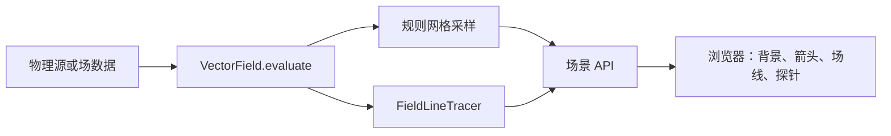

# VectorViz

VectorViz 用 Python 计算向量场和场线，并在浏览器中显示结果。场公式只实现一次：同一个场对象用于批量采样、数值追踪和测试，前端热图、箭头与探针也读取它的结果。

当前版本可以在浏览器中查看电偶极子、电四极子、六个正电荷、三对交替电荷、理想磁偶极子、线性 Halbach 阵列、圆形电流线圈、带电圆环、匀强场中的介质球与导体球，以及匀强场。点源可以增删和拖动，面内磁偶极矩还可旋转；圆环的两个截面标记则是只读几何。图中同时显示单位、枚举播种模式与具体说明、切片含义、双端终止统计、抑制数和实际渲染数；探针吸附到最近的网格点并显示未被色标上下界裁剪的原始有限场值和场方向。图框旁的工具栏可以单独开关热图、斜率短线、场线、方向、场源、网格和光标预览七个图层，切换不重新计算；响应附带与标量同一次求值的向量分量，光标周围的预览束在浏览器里由网格插值得到，点击即可让服务端从该点精确积分一条场线。

磁静态预设还包括直导线、同向/反向双导线、有限螺线管和 Helmholtz/反 Helmholtz 线圈。这六个场景的几何固定，电流截面以 ⊙/⊗ 标记，仍可开关全部图层、移动探针和点击添加手动种子。螺线管明确采用有限个同轴圆电流环的离散绕组近似，场线使用覆盖播种。

v0.3.9 新增 Laplace 鞍点与三阶多极、线性与 Logistic 斜率场、理想磁屏蔽筒，合计 22 个预设。四个数学场景使用无量纲坐标，磁屏蔽筒使用 m 与 T；内外两条圆界面之间是恒定磁导率材料，内腔仍有减弱后的有限磁场。这个解析基准只描述无限长圆柱壳在横向匀强外场中的响应，有限长、开口、多层和真实材料非线性仍属后续范围。

## 第一次使用

1. 跟着[快速开始](getting-started.md)用 uv 安装并启动服务。
2. 打开浏览器前端，先比较内置预设。
3. 阅读[场线是什么](tutorial/01-field-lines.md)，再看[切片、播种与验证](tutorial/04-slices-and-validation.md)。这两章解释图上的线能说什么、不能说什么。
4. 要添加模型时，从[从物理源到向量场](tutorial/02-field-models.md)和[开发指南](development.md)开始。

其他文档：

- [物理与数学建模教程](physics-and-numerics.md)
- [系统架构](architecture.md)
- [Python 与 HTTP API](api.md)
- [参考资料](references.md)

## 场景数据如何生成



物理公式和作为场景结果返回的自适应积分在 Python 服务端完成。浏览器只对返回的向量网格做插值与定步长 RK4，生成明确标识的光标预览；预览用于选择种子，服务端再直接对场模型追踪。更换色图不需重算场，更换种子不需重建模型；源集合、位置、强度或方向角变化时，已有场值才失效。

拖动源时，新位置与旧场暂时不属于同一物理场景。界面会隐藏旧热图和场线、显示“场待重算”，并在松开后只提交一次合法最终位置；它不会把旧计算结果混画到新源上。

## 看图前先确认四件事

1. **曲线类型**：是真实场线、投影流线，还是三维曲线的二维投影？
2. **颜色含义**：画的是完整场强、平面内场强，还是某个带符号分量？
3. **种子来源**：线条是为画面均匀而放，还是每条代表相同通量？
4. **斜线与空白**：图框内的灰底斜线是无法着色的格点，来自 JSON `null` 标出的奇点 mask，或对数色标无法显示的非正值；图框外的空白才是计算域之外。

!!! warning "场线不是粒子轨迹"
    场线只要求曲线切向与场方向一致。带电粒子还需要质量和初速度；黑洞光线是四维时空中的零测地线。三者可以共用部分数值工具，但不能共用同一条动力学方程。

## 启动

```powershell
uv sync
uv run vectorviz
```

前端位于 <http://127.0.0.1:8000>。文档预览使用另一个端口：

```powershell
uv run mkdocs serve
```

打开 <http://127.0.0.1:8001>。两个服务可以同时运行。
